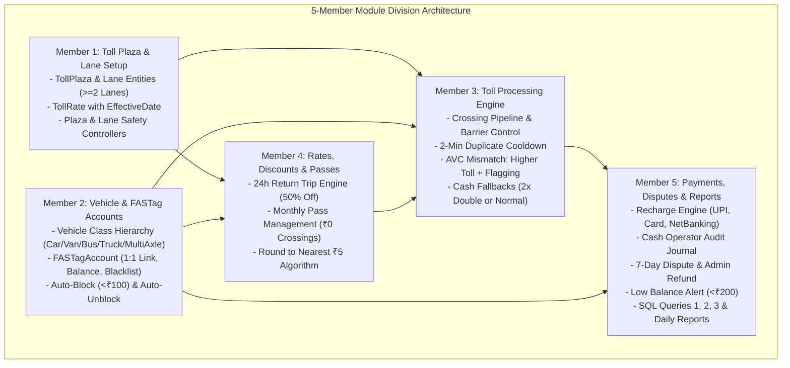
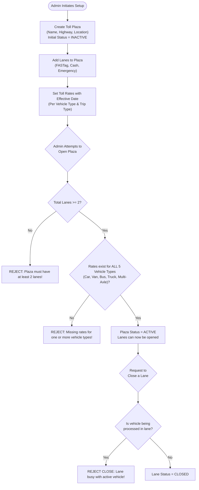
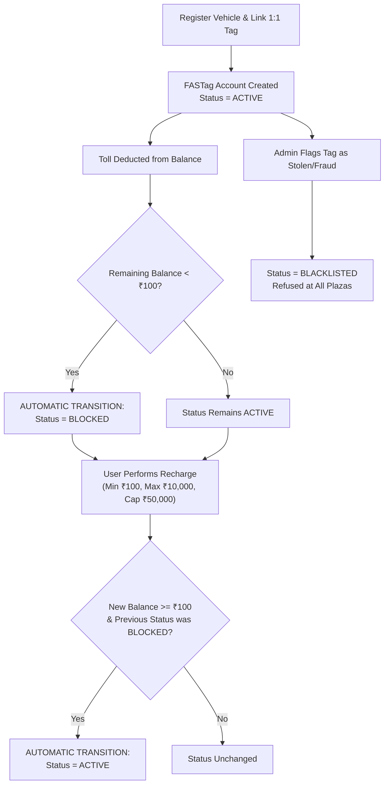
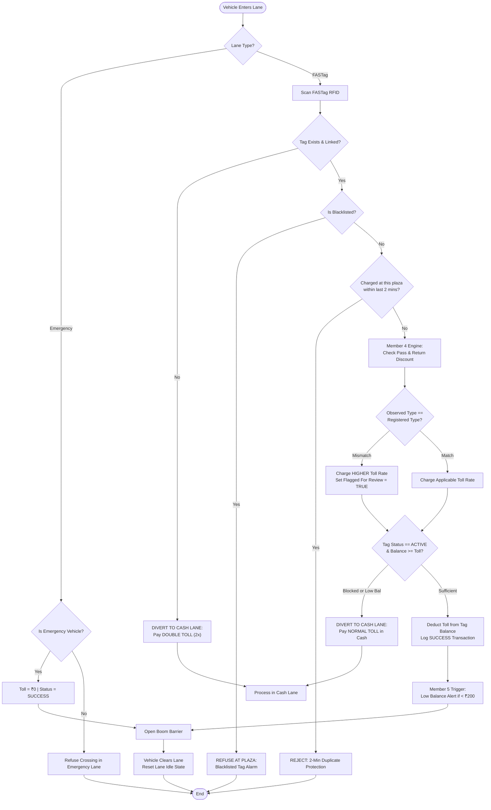
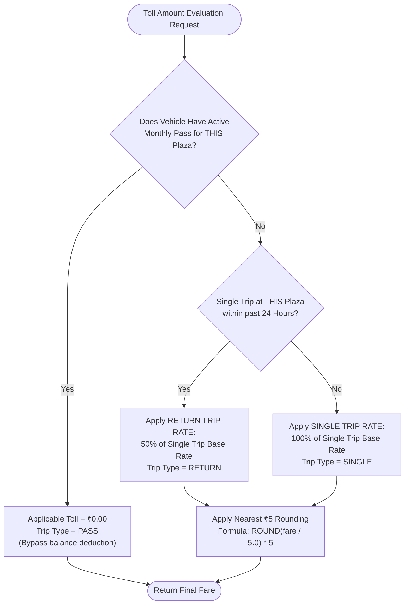
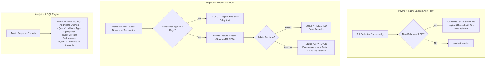
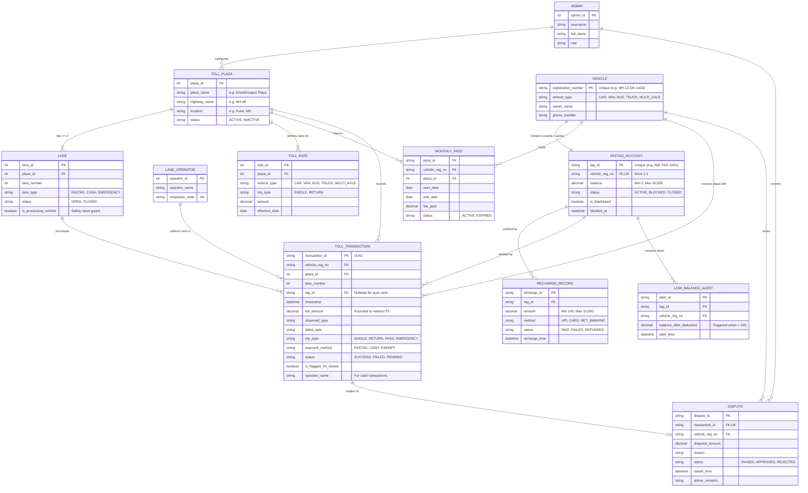
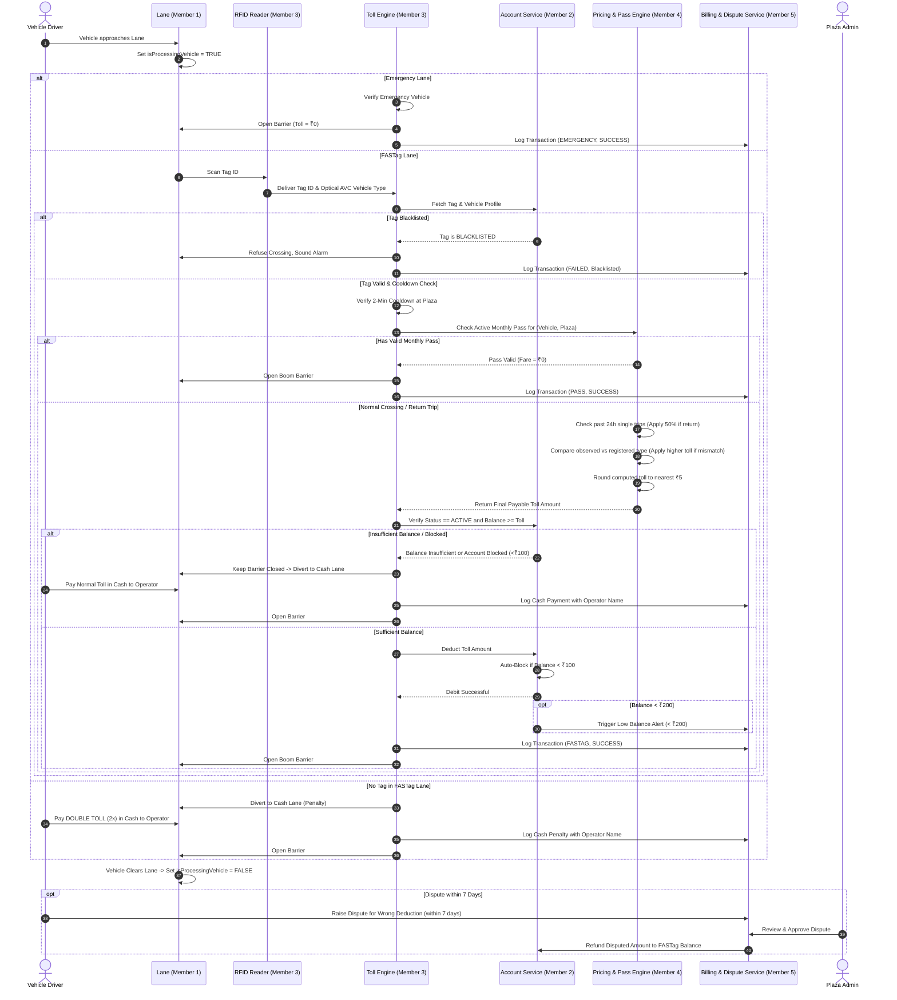
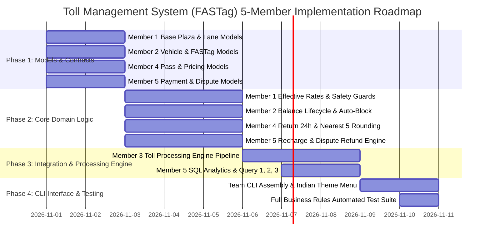

# Toll Management System (FASTag)
## Implementation Plan, 5-Member Module Division, ER Diagram & Workflows

---

## 1. Project Overview & Indian Highway FASTag Context

The **Toll Management System (FASTag)** is an automated highway toll collection application modeled on Indian National Highway Authority of India (NHAI) and MoRTH guidelines. It handles electronic toll collection (ETC) using RFID FASTags, cash and emergency fallback lanes, automated dynamic rate discounting (24-hour return trips, monthly passes), balance lifecycle management, dispute handling, and analytical reporting.

### Core Technical Pillars:
- **Language**: Java (Standard SE 8 / 11 / 17 / 21) — no third-party library dependencies.
- **Architecture**: Domain-Driven Design (DDD) with clear separation of models, services, repositories, and CLI presentation.
- **Storage**: In-Memory Collections (`ConcurrentHashMap`, `CopyOnWriteArrayList`, `PriorityQueue`) for thread-safe runtime state management.
- **Interface**: Indian Highway themed Interactive Console CLI (with ANSI terminal colors, ASCII tables, and automated simulation modes).
- **OOP Tenets**:
  - **Encapsulation**: Private fields, immutable identifiers, state mutations strictly via validated business methods.
  - **Inheritance**: `Vehicle` hierarchy (`Car`, `Van`, `Bus`, `Truck`, `MultiAxleVehicle`) and `Lane` hierarchy (`FASTagLane`, `CashLane`, `EmergencyLane`).
  - **Polymorphism**: `PaymentMethod` strategy interface (`FASTagPayment`, `CashPayment`) executing payments polymorphically.
  - **Abstraction**: High-level service contracts (`IPlazaService`, `IAccountService`, `ITollProcessingService`, `IPricingService`, `IBillingReportingService`).

---

## 2. 5-Member Team Allocation & Responsibility Matrix

The system is partitioned into **5 autonomous modules**, each assigned to a dedicated team member. Clear interface contracts ensure independent development, unit testing, and smooth integration.

| Member | Role & Ownership | Module Name | Core Domain Deliverables | Direct Dependencies |
| :--- | :--- | :--- | :--- | :--- |
| **Member 1** | **Infrastructure & Setup Lead** | **Module 1: Toll Plaza & Lane Setup** | Toll Plaza lifecycle, Multi-modal Lanes ($\ge 2$), Rate Configurations, Effective Dating engine, Lane Processing Locks. | None (Base Infrastructure) |
| **Member 2** | **Account & Identity Lead** | **Module 2: Vehicle & FASTag Accounts** | Vehicle Registry, 1:1 Tag Association, Balance Lifecycle (₹100–₹50k), Auto-block (<₹100), Auto-unblock, Admin Blacklisting. | `Vehicle` models |
| **Member 3** | **Edge & Toll Processing Lead** | **Module 3: Toll Processing Engine** | RFID Crossing Engine, 2-Min Anti-Double-Billing, Emergency Bypass, AVC Mismatch Detection & Flagging, Cash Fallback Router. | Modules 1, 2, 4, 5 |
| **Member 4** | **Pricing & Subscription Lead** | **Module 4: Rates, Discounts & Passes** | 24-Hour Return Trip (50% discount) engine, Monthly Pass Issuance & Validation, Nearest ₹5 Rounding Algorithm. | Modules 1, 2 |
| **Member 5** | **Billing, Disputes & Analytics Lead**| **Module 5: Payments, Disputes & Reports** | Recharge Transactions (UPI/Card/NetBanking), Cash Operator Auditing, 7-Day Dispute & Refund Engine, Low Balance Alerts (<₹200), SQL Queries 1, 2, 3. | Modules 2, 3 |

---

## 3. Detailed Module Breakdown for the 5 Team Members

---

### Member 1: Infrastructure & Setup Lead
#### **Module 1: Toll Plaza and Lane Setup**
* **Assigned Member**: Developer 1 (Infrastructure Lead)
* **Package**: `com.toll.module1.plaza`
* **Core Responsibilities**:
  1. **Toll Plaza Administration**: Only an Admin can create plazas. A plaza has an ID, name (e.g. *Khedshivapur Plaza*, *Kherki Daula Plaza*), highway name (e.g. *NH-48*, *NH-44*), location, and must have **at least 2 lanes**.
  2. **Lane Lifecycle & Safety**:
     - Lane types: `FASTAG`, `CASH`, `EMERGENCY`.
     - Status: `OPEN`, `CLOSED`.
     - **Safety Rule**: A lane can be set to `CLOSED` **only if** `isProcessingVehicle == false`. Closing is rejected if a vehicle is in the middle of crossing.
  3. **Effective Dating Rate Engine**:
     - Rates configured per plaza, vehicle type (`CAR`, `VAN`, `BUS`, `TRUCK`, `MULTI_AXLE`), and trip type (`SINGLE`, `RETURN`) with an `effectiveDate`.
     - **Plaza Opening Guard**: A plaza **cannot open** until an active rate exists for **every vehicle type**.
     - Rate changes apply **strictly on or after** the effective date without modifying past transaction historical rates.
* **Key Classes & Interfaces**:
  - `TollPlaza.java`: Encapsulates plaza attributes, list of lanes, and rate tables.
  - `Lane.java` *(Abstract)*: Base class with `laneNumber`, `status`, `isProcessingVehicle`.
  - `FASTagLane.java`, `CashLane.java`, `EmergencyLane.java` *(Subclasses)*.
  - `TollRate.java`: Stores plaza, vehicle type, trip type, rate amount, and effective date.
  - `IPlazaService.java` & `PlazaServiceImpl.java`: Admin operations and readiness validations.
* **Module 1 Specific Workflow**:

---

### Member 2: Account & Identity Lead
#### **Module 2: Vehicle and FASTag Accounts**
* **Assigned Member**: Developer 2 (Account & Identity Lead)
* **Package**: `com.toll.module2.account`
* **Core Responsibilities**:
  1. **Vehicle Registry & Hierarchy**:
     - Base `Vehicle` class extended by `Car`, `Van`, `Bus`, `Truck`, and `MultiAxleVehicle`.
     - Unique Indian registration number (e.g. `MH-12-DE-1433`, `DL-01-AB-1234`), owner name, phone number.
  2. **1:1 FASTag Account Association**:
     - Exactly one active tag linked per vehicle.
     - Unique `tagId` (e.g. `IND-FASTAG-7001`).
  3. **Balance Rules & State Transitions**:
     - Status: `ACTIVE`, `BLOCKED`, `CLOSED`.
     - Balance must **never be negative**. Max allowed balance is **₹50,000**.
     - **Auto-Block**: Automatically transitions to `BLOCKED` if balance drops below **₹100**.
     - **Auto-Unblock**: A blocked tag automatically returns to `ACTIVE` when a recharge takes balance to **$\ge$ ₹100**.
     - Recharge bounds: Minimum **₹100**, maximum **₹10,000** per recharge transaction.
  4. **Admin Blacklist Engine**:
     - Admin can blacklist fraudulent or stolen tags. Blacklisted tags are rejected at all plazas.
* **Key Classes & Interfaces**:
  - `Vehicle.java` *(Abstract)*, `Car.java`, `Van.java`, `Bus.java`, `Truck.java`, `MultiAxleVehicle.java`.
  - `FASTagAccount.java`: Private balance, status, blacklisted flag, mutators with automatic state triggers.
  - `IAccountService.java` & `AccountServiceImpl.java`: Registry management, recharges, blacklisting.
* **Module 2 Specific Workflow**:

---

### Member 3: Edge & Toll Processing Lead
#### **Module 3: Toll Processing Engine**
* **Assigned Member**: Developer 3 (Core Processing Lead)
* **Package**: `com.toll.module3.tollengine`
* **Core Responsibilities**:
  1. **Real-time Lane Crossing Pipeline**:
     - Reads RFID tag and fetches linked vehicle.
     - Controls barrier actuator: barrier opens **only after** toll is deducted successfully.
  2. **Emergency Lane Bypass**:
     - Emergency vehicles (Ambulance, Fire Engine) crossing via Emergency Lane pay **₹0** toll.
  3. **Anti-Tailgating & Anti-Double-Billing**:
     - The same tag **cannot be charged twice** at the same plaza within **2 minutes**.
  4. **Vehicle Type Mismatch Enforcement**:
     - If optical AVC (observed vehicle type) differs from registered type, the **higher toll** is charged, and `isFlaggedForReview` is set to `true`.
  5. **Cash Lane Fallback Routing**:
     - **No Valid Active Tag**: Diverted to Cash Lane and charged **Double Toll (2x)**.
     - **Insufficient Balance**: Barrier stays closed. Diverted to Cash Lane and pays **Normal Toll** in cash.
  6. **Transaction Logging**:
     - Creates immutable `TollTransaction` record (UUID, vehicle, plaza, lane, timestamp, amount, status, failure reason, flag status).
* **Key Classes & Interfaces**:
  - `TollTransaction.java`: Data model capturing crossing details and review flags.
  - `ITollProcessingService.java` & `TollProcessingServiceImpl.java`: Orchestrates the crossing pipeline.
  - `CrossingContext.java`: Value object encapsulating lane, tag, observed vehicle type, and timestamp.
* **Module 3 Specific Workflow**:

---

### Member 4: Pricing & Subscription Lead
#### **Module 4: Rates, Discounts and Passes**
* **Assigned Member**: Developer 4 (Pricing & Subscription Lead)
* **Package**: `com.toll.module4.pricing`
* **Core Responsibilities**:
  1. **24-Hour Return Trip Discount Engine**:
     - If a vehicle returns through the same plaza within **24 hours** of a previous Single trip, the **Return Trip Rate (50% of Single trip rate)** is applied automatically.
  2. **Monthly Pass Management**:
     - Vehicle owner can hold a monthly pass for a specific plaza with a valid start and end date.
     - Rule: A vehicle can have **only one valid pass per plaza** at a time.
     - A vehicle with a valid pass pays **₹0** toll at that plaza.
     - Pass fees are configured by Admin per vehicle type and plaza.
  3. **Nearest ₹5 Rounding Algorithm**:
     - All computed toll amounts must be mathematically rounded to the nearest ₹5:
       $$\text{Rounded Amount} = \text{Math.round}(\text{amount} / 5.0) \times 5$$
* **Key Classes & Interfaces**:
  - `MonthlyPass.java`: Encapsulates pass ID, vehicle reg number, plaza ID, date range, fee, and validity checker.
  - `IPricingService.java` & `PricingServiceImpl.java`: Rates calculation, return trip detection, rounding logic.
  - `PassFeeConfig.java`: Configuration of pass rates per vehicle type.
* **Module 4 Specific Workflow**:

---

### Member 5: Billing, Disputes & Analytics Lead
#### **Module 5: Payments, Disputes and Reports**
* **Assigned Member**: Developer 5 (Billing & Analytics Lead)
* **Package**: `com.toll.module5.billing`
* **Core Responsibilities**:
  1. **Polymorphic Payment System**:
     - `PaymentMethod` interface with `FASTagPaymentMethod` and `CashPaymentMethod`.
     - Cash toll payments record collected amount and the **Lane Operator Name / ID**.
     - Recharge methods: `UPI`, `CARD`, `NET_BANKING`. Stores recharge amount, date, method, and status (`PAID`, `FAILED`, `REFUNDED`).
  2. **7-Day Dispute & Refund Engine**:
     - A vehicle owner can raise a dispute for a wrong deduction within **7 days** of transaction timestamp. Disputes older than 7 days are rejected.
     - Admin can review, approve, or reject. Upon approval, the disputed amount is **automatically refunded to the tag balance**.
  3. **Low Balance Alert Trigger**:
     - When balance drops below **₹200** after a deduction, an automated `LowBalanceAlert` is generated.
  4. **Reporting & SQL Analytics**:
     - Daily revenue report per plaza.
     - Total vehicle count per lane.
     - **SQL Exercise Query 1**: Vehicle type revenue summary (>2 successful txns, sorted by toll DESC).
     - **SQL Exercise Query 2**: Plaza crossing & failure audit ($\ge 3$ crossings).
     - **SQL Exercise Query 3**: Multi-plaza account analysis (>2 distinct plazas, sorted by amount DESC).
* **Key Classes & Interfaces**:
  - `PaymentMethod.java` *(Interface)*, `FASTagPayment.java`, `CashPayment.java`.
  - `RechargeRecord.java`, `Dispute.java`, `LowBalanceAlert.java`.
  - `IBillingReportingService.java` & `BillingReportingServiceImpl.java`.
* **Module 5 Specific Workflow**:

---

## 4. Complete Entity-Relationship (ER) Diagram

---

## 5. End-to-End Integrated System Workflow

This diagram unites all 5 members' deliverables into one continuous operational flow:

---

## 6. Implementation Timeline & Integration Roadmap

---

## 7. Individual Member Acceptance Criteria Checklist

### Member 1 Checklist (Plaza & Lanes)
- [ ] Plazas enforce a minimum of 2 lanes.
- [ ] Plaza open status blocked unless rates exist for all 5 vehicle types (`CAR`, `VAN`, `BUS`, `TRUCK`, `MULTI_AXLE`).
- [ ] Rate effective date is strictly honored without altering historical transaction rates.
- [ ] Lane close operation blocked if `isProcessingVehicle == true`.

### Member 2 Checklist (Vehicles & Accounts)
- [ ] Vehicle registration numbers are unique.
- [ ] FASTag account is linked strictly 1:1 with a vehicle.
- [ ] Balance never negative; maximum balance capped at ₹50,000.
- [ ] Auto-block triggers when balance < ₹100.
- [ ] Auto-unblock triggers when recharge takes balance $\ge$ ₹100.
- [ ] Blacklisted tags are rejected at all plazas.

### Member 3 Checklist (Toll Processing Engine)
- [ ] Barrier opens only after successful deduction or valid pass.
- [ ] Emergency vehicles pay ₹0 in Emergency Lane.
- [ ] 2-minute cooldown prevents double-charging the same tag at the same plaza.
- [ ] Observed vehicle mismatch charges the higher toll and sets `isFlaggedForReview = true`.
- [ ] Missing tag charged Double Toll (2x) in Cash Lane.
- [ ] Insufficient balance charged Normal Toll in Cash Lane.

### Member 4 Checklist (Rates & Passes)
- [ ] 24-hour return trip automatically applies 50% discount on Single trip rate.
- [ ] Monthly pass allows unlimited ₹0 toll crossings at designated plaza.
- [ ] Only one active monthly pass allowed per vehicle per plaza.
- [ ] All final toll amounts rounded to nearest ₹5 (`ROUND(amount / 5.0) * 5`).

### Member 5 Checklist (Payments, Disputes & Reports)
- [ ] Recharge accepts UPI, Card, Net Banking with ₹100–₹10,000 bounds.
- [ ] Cash toll transactions record the collecting Lane Operator's name.
- [ ] Disputes allowed strictly within 7 days of crossing; approved disputes refund directly to FASTag balance.
- [ ] Low balance alerts trigger when balance drops below ₹200.
- [ ] In-memory execution of SQL Queries 1, 2, and 3 produces exact grouped/filtered results.
